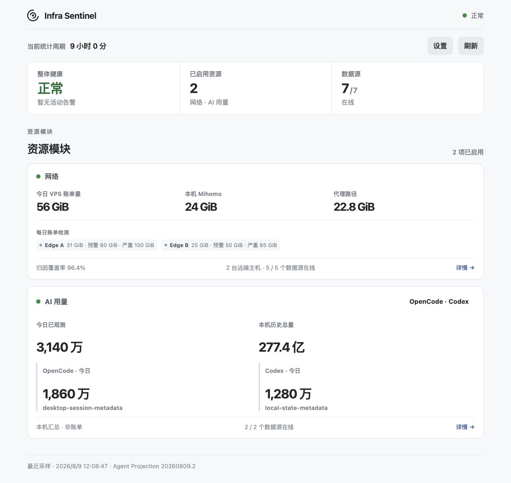
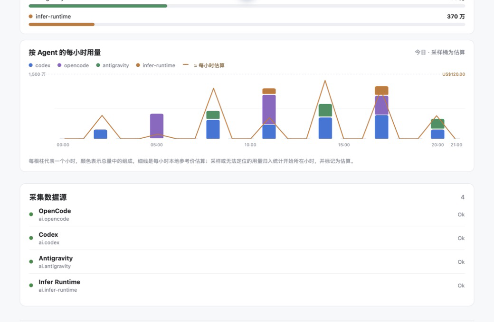
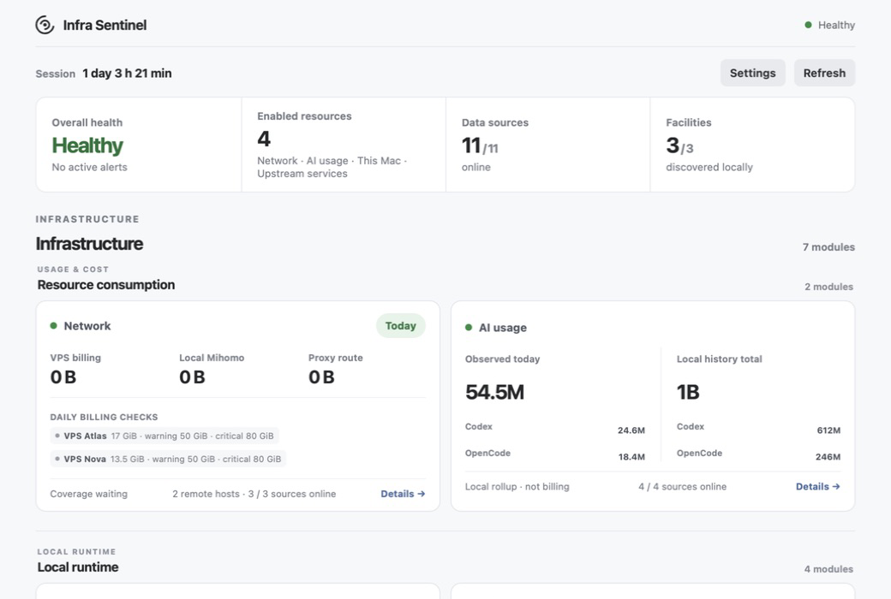
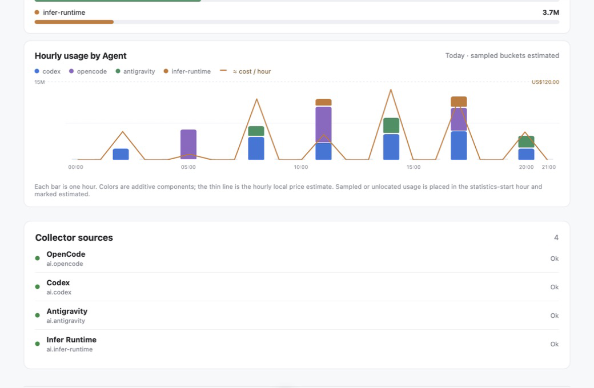

# Infra Sentinel

**中文** · [English](#english)

当前版本：[2.1.1](https://github.com/glenzli/infra-sentinel/releases/tag/v2.1.1) · [更新日志](CHANGELOG.md)

Infra Sentinel 是一个 macOS 桌面监控工具，用于查看网络流量、AI 客户端用量、本机资源、远端主机和服务状态。各类数据按来源和单位分别展示。



> 截图使用匿名演示数据，不含真实主机名、IP、账户、路径或项目内容。

## 支持范围

- **本机网络**：Mihomo / Clash Meta 兼容内核的连接、域名和代理路径归因。
- **AI 用量**：Codex 桌面端与 CLI、OpenCode Desktop、DSH（DeepSeek Harness）、Antigravity、Antigravity IDE / CLI，以及已接入的 Infer Runtime。
- **本机资源**：CPU、内存压力、Swap、磁盘吞吐、IOPS、容量、温度压力，以及尽力而为的 App 磁盘 I/O 归因。macOS 自动探测已安装的 `smartctl`，有可读 NVMe SMART 数据时补充 SSD 温度、寿命已用比例和累计读写量；每 10 分钟读取，不自动安装或提权。
- **远端主机**：通过本机 `~/.ssh/config` Host 别名读取 Linux 网卡统计；可选接入 Xray 用户逻辑流量。
- **上游状态**：OpenAI、Claude、DeepSeek、Kimi / Moonshot 和 Cursor 的公开官方状态页。
- **本地设施**：通过 [Infra Protocol](https://github.com/glenzli/infra-protocol) 发现 PCP、Infer Runtime、Dev Mesh Observer 等兼容服务。

## 使用方式

启动 App 后，应用会管理本地采样进程；关闭主窗口后继续驻留菜单栏。首次启动会创建：

```text
~/Library/Application Support/Infra Sentinel/config.toml
```

Mihomo 默认自动发现。远端 VPS 在设置中填写已存在于 `~/.ssh/config` 的 Host 别名；App 只记录别名，不复制 SSH 密钥、密码或 `HostName`。

```sshconfig
Host edge-a
  HostName vps.example.com
  User root
  IdentityFile ~/.ssh/id_ed25519
```

Xray 用户统计为可选功能。每个客户端需要独立的 `email` 标签，StatsService 应只监听远端回环地址。

## AI 用量统计

Codex 用量从本机 rollout JSONL 中读取每次请求的 `last_token_usage` 增量，不使用 `threads.tokens_used` 计算。统计会排除 fork 回放和跨文件重复记录。持久化数据只包含聚合用量、解析状态和去重标记，不包含任务内容。

DSH（DeepSeek Harness）从 `~/.dsh/sessions`（或 `$DSH_HOME/sessions`）只读解析 v4 JSONL / Zstd 会话中的供应商用量，每分钟检查一次。统计包含输入、输出、缓存和按模型、自然日、小时的历史；同次调用的流式与最终报告只计一次，重试单独计数，明确的继承前缀不重复计入。旧会话按事件时间归档，不按文件修改时间计入今日。不会读取凭据或保留对话正文，也不推测模型价格别名。压缩日志在 Python 3.14+ 上直接支持；较早 Python 可安装 `.[dsh]`。

新版 Codex 日志提供计时字段时，AI 用量页会按模型分别保留主对话最近完成轮次的平均输出 `tokens/s`、首 Token 延迟和整轮耗时。平均速度为本轮输出 Token（含推理）除以 Codex 记录的整轮耗时，包含等待与工具执行，不代表纯生成速度。沿用现有约 20 秒的采集间隔，完成后更新；缺少可靠字段时不显示。已有账本无需重建，可读取的旧日志会分批补齐各模型计时，不重复累计 Token。

OpenCode 按已完成用户轮次汇总输出并显示轮次平均（含工具）；DSH 从带时间戳的响应流读取请求平均与客户端流速；Antigravity 使用生成元数据中的首 Token 延迟和流式耗时。请求平均包含首输出等待，客户端流速不含该等待且可能受缓冲交付影响；三种口径分别标注，不作为可互比的纯模型生成速度。缺少可靠起止或重试起点时保持缺失，不改动 Token 用量账本。

每个客户端按精确模型名独立保留最新有效样本；切换模型不会覆盖其他模型的速度。用量总览和模型分析只显示所选时段内的速度样本。样本旁显示模型名，悬停或聚焦可查看记录时间和计时口径；尚未完成的轮次不替换已有记录。

图表显示本机记录到的原始 Token，不是 Codex 账户额度或账单。API 参考价值按模型的输入、缓存输入、缓存写入和输出价格换算。价格目录来自独立的 [api-price](https://github.com/glenzli/api-price) Release：Agent 每日检查一次，遇到没有精确价格的模型时至多每六小时补查一次，也可在设置中手动检查。下载内容会校验大小、结构和 SHA-256；失败时继续使用最后一个有效版本或 App 内置目录。检查请求不包含本机模型 ID 或用量。Antigravity 精确模型价优先；有限后缀可采用标明的本体参考估算，保留原始模型名。`-trial`/`-trail` 标为“试用”，`-free` 标为“免费版”，与 `-n` 等“疑似灰度”分开提示与计数；名称中的试用或免费不代表 API 参考价值为零，实际扣费以供应商为准。未知本体、未支持后缀以及不适用日期仍保持未计价。

“Agent 活动”默认每个来源一行摘要，展开后以双列排列指标，并保留当前选择的展开状态。长说明通过 ⓘ 悬停或键盘聚焦查看；浮层支持方向键滚动和 Esc 关闭。

当日用量按小时展示。有时间戳的来源按事件时间归桶；只提供累计值的来源按采样差分归桶。无法定位的起始余额归入统计开始所在小时，并标记为估算。跨日后按自然日汇总。



*当日 Token 小时桶与本地 API 参考价值；图中为匿名演示数据。*

从旧版本升级时，Agent 会先备份旧 SQLite 和 Codex 检查点，重建当前仍可见的 Codex 历史，再替换旧的 Codex 指标。已记入聚合账本的历史不受后续删除任务影响；其他机器和升级前已删除的任务无法补录。

如需核对本机仍可见的 Codex JSONL，可从源码运行只读审计：

```sh
PYTHONPATH=src python3 -m infra_sentinel.cli.codex_usage_audit \
  --from 2026-08-22 --to 2026-08-23 --timezone Asia/Shanghai
```

## 诊断历史

概览中的诊断入口汇总采集来源、网络、本机资源、本地设施和上游状态的异常。历史页按时间和类别查看首次发现、级别变化与确认恢复；重复采样和 App 重启不会重复创建同一异常。来源消失、停用或数据过期时，未解决的异常保留为待确认，不会显示成恢复。

诊断历史从启用后开始记录，最多保留 30 天并受条数上限约束。记录仅包含固定原因、级别、来源标识和观测时间，不保存原始错误、任务内容或请求参数，也不自动判定跨资源因果关系。

其他 Agent 可通过只读 JSON 查询获得同一份记录：

```sh
PYTHONPATH=src python3 -m infra_sentinel.cli.diagnostics --hours 24 --limit 50
```

打包后的 `infra-agent --diagnostics` 也可查询已有状态；查询不启动采集、不创建缺失的历史库。过滤参数、覆盖范围和时间语义见 [诊断接口](docs/diagnostics.md)。

## 安装与构建

从 [2.1.1 Release](https://github.com/glenzli/infra-sentinel/releases/tag/v2.1.1) 下载 Apple Silicon App ZIP 和对应 SHA-256 校验文件。

当前桌面包支持 macOS 13+。预编译 App 使用 ad-hoc 签名，未经 Apple 公证；首次启动如被 macOS 拦截，可右键选择“打开”，或在“系统设置 → 隐私与安全性”中确认。

从 Traffic Sentinel 1.0.0 升级时，macOS 会把 Infra Sentinel 识别为独立 App。首次启动仅在新版配置不存在时复制旧的 `Traffic Sentinel/config.toml`；旧目录不会被删除，v1 的历史采样也不会导入新版指标库。

从源码构建需要 Xcode Command Line Tools、Rust、Node.js LTS、Python 3.11+ 与 PyInstaller：

```sh
git clone git@github.com:glenzli/infra-sentinel.git
cd infra-sentinel
python3 -m pip install . pyinstaller
./bin/build-desktop-app.sh
open "ui/src-tauri/target/release/bundle/macos/Infra Sentinel.app"
```

## 数据与隐私

采集为只读操作：不抓包，不采集或保存提示词、响应、项目文件和凭据，也不修改代理或远端服务配置。上游状态检查只访问供应商的公开状态页。

本地状态保存在：

```text
~/Library/Application Support/Infra Sentinel/state/
```

状态数据可能包含聚合域名、模型名、Xray 客户端标签和用户设置的显示名。默认情况下，采集、存储和分析均在本机完成。

实现与架构说明见 [docs](docs/)、[ROADMAP.md](ROADMAP.md) 和 [设施发现说明](docs/facility-discovery.md)。

## 开发验证

```sh
python3 -m unittest discover -s tests -v
cd ui && npm run build
cd src-tauri && cargo test --offline
```

---

## English

[中文](#infra-sentinel)

Current release: [2.1.1](https://github.com/glenzli/infra-sentinel/releases/tag/v2.1.1) · [Changelog](CHANGELOG.md)

Infra Sentinel is a macOS desktop monitor for network traffic, local AI-client usage, host resources, remote hosts, and service status. Each source keeps its own units and accounting method.



### Supported sources

- **Local network**: connection, domain, and proxy-route attribution from Mihomo / Clash Meta-compatible cores.
- **AI usage**: Codex desktop and CLI, OpenCode Desktop, DSH (DeepSeek Harness), Antigravity, Antigravity IDE / CLI, and connected Infer Runtime instances.
- **Host resources**: CPU, memory pressure, swap, disk throughput, IOPS, capacity, thermal pressure, and best-effort per-app disk I/O attribution on macOS.
- **Remote hosts**: Linux interface counters through an existing SSH Host alias, with optional Xray per-user logical traffic.
- **Provider status**: public status pages for OpenAI, Claude, DeepSeek, Kimi / Moonshot, and Cursor.
- **Local facilities**: PCP, Infer Runtime, Dev Mesh Observer, and other compatible services discovered through [Infra Protocol](https://github.com/glenzli/infra-protocol).

### Running the app

The app manages the local sampling process and remains in the menu bar after its main window closes. On first launch it creates:

```text
~/Library/Application Support/Infra Sentinel/config.toml
```

Mihomo is discovered automatically. Remote hosts are configured by an existing `~/.ssh/config` Host alias; Infra Sentinel records the alias without copying SSH keys, passwords, or `HostName`. Xray user statistics are optional and require a separate `email` label for each client. StatsService should listen only on the remote loopback interface.

### AI usage accounting

Codex usage is calculated from per-request `last_token_usage` increments in local rollout JSONL. `threads.tokens_used` is not used. Fork replay and duplicate records across files are removed. The persistent ledger contains aggregate usage, parser state, and deduplication markers, but no task content.

DSH (DeepSeek Harness) reads provider usage from local v4 JSONL / Zstd sessions under `~/.dsh/sessions` (or `$DSH_HOME/sessions`), checked once a minute. It includes input, output, cache, model, daily and hourly history. Final usage replaces streaming reports for the same attempt; retries count separately and explicit inherited prefixes are excluded. Historical usage follows event timestamps, not file modification time. Credentials and transcript content are not retained, and model-price aliases are not inferred. Compressed logs work with Python 3.14+; earlier Python versions can install `.[dsh]`.

When newer Codex logs provide timing metadata, AI usage keeps each model's latest completed main-chat turn's average output `tokens/s`, first-token latency, and duration. The average divides turn output Tokens (including reasoning) by Codex-reported turn duration, including waiting and tool execution; it is not pure generation speed. Results update after completion on the existing roughly 20-second collection cadence. Missing reliable timing stays absent. Existing ledgers need no rebuild: readable old logs backfill model timing in batches without replaying Token accounting.

OpenCode shows a completed user-turn average including tools. DSH reads request averages and client stream rates from timed response streams; Antigravity uses recorded first-token and streaming durations. Request averages include first-output waiting. Client stream rates exclude it and may be inflated by buffering; these scopes remain separately labeled. Missing timing or an unknown retry start stays absent and never changes Token accounting.

Each client keeps the latest usable sample independently for each exact model ID. Switching models preserves the other models' rates. Usage overview and model analysis only show performance samples recorded in the selected time range. Samples show their model; hover or focus reveals the recording time and timing scope. Unfinished turns do not replace completed samples.

Charts show raw Tokens recorded on this machine, not Codex account quota or billing. API reference value is calculated from model-specific input, cached-input, cache-write, and output prices. The price catalog comes from independent [api-price](https://github.com/glenzli/api-price) Releases. The Agent checks daily, checks at most every six hours when an exact model price is missing, and also offers a manual check in Settings. Downloads are validated for size, structure, and SHA-256; failures retain the last valid or bundled catalog. Update requests contain no local model IDs or usage. Antigravity exact prices take priority; bounded suffixes may use labeled base-model estimates while preserving raw IDs. `-trial`/`-trail` are labeled Trial and `-free` Free tier, separately from suspected rollouts such as `-n`. These name markers do not imply zero API reference value or establish actual charges. Unknown bases, unsupported suffixes and unavailable usage dates remain unpriced.

Agent activity starts with one summary row per provider. Expanded metrics use two compact columns and retain the current expansion choices. Hover or focus ⓘ to read explanations; arrow keys scroll long hints and Esc closes them.

The current day is displayed in hourly buckets. Timestamped sources use event time; cumulative-only sources use sampled deltas. An opening balance that cannot be located is assigned to the statistics-start hour and marked as estimated. Older data is summarized by calendar day.



*Hourly Token buckets and local API reference value for the current day, using anonymous demo data.*

When upgrading from the legacy accounting format, the Agent backs up the old SQLite store and Codex checkpoints, rebuilds the Codex history still visible on this machine, and replaces the old Codex metrics. History already captured in the aggregate ledger remains after a task is deleted. Data from other machines and tasks deleted before the upgrade cannot be recovered.

To audit the Codex JSONL still visible on this machine:

```sh
PYTHONPATH=src python3 -m infra_sentinel.cli.codex_usage_audit \
  --from 2026-08-22 --to 2026-08-23 --timezone Asia/Shanghai
```

### Diagnostic history

The overview links to a unified history of collection, network, host, facility, and upstream conditions. Filter first observations, severity changes, and confirmed recoveries by time and category. Repeated samples and restarts do not replay an unchanged condition. Missing, disabled, or stale observation leaves unresolved conditions unconfirmed rather than recovered.

History starts when collection is enabled and is bounded by a 30-day retention period and a row cap. Records contain fixed reasons, severity, source identity, and observation time; they exclude raw errors, task content, and request parameters. Concurrent events do not establish causality.

Local agents can query the same records as read-only JSON:

```sh
PYTHONPATH=src python3 -m infra_sentinel.cli.diagnostics --hours 24 --limit 50
```

The packaged `infra-agent --diagnostics` also reads existing state without starting collection or creating a missing journal. See [the diagnostic interface](docs/diagnostics.md) for filters, coverage, and time semantics.

### Build

Download the Apple Silicon App ZIP and its SHA-256 checksum from the [2.1.1 Release](https://github.com/glenzli/infra-sentinel/releases/tag/v2.1.1).

The desktop package supports macOS 13+. Prebuilt apps use ad-hoc signing and are not notarized by Apple. Building from source requires Xcode Command Line Tools, Rust, Node.js LTS, Python 3.11+, and PyInstaller:

When upgrading from Traffic Sentinel 1.0.0, macOS treats Infra Sentinel as a separate app. On first launch it copies the old `Traffic Sentinel/config.toml` only when no Infra Sentinel configuration exists. The legacy directory is retained, and v1 sample history is not imported into the new metric store.

```sh
git clone git@github.com:glenzli/infra-sentinel.git
cd infra-sentinel
python3 -m pip install . pyinstaller
./bin/build-desktop-app.sh
open "ui/src-tauri/target/release/bundle/macos/Infra Sentinel.app"
```

### Data and privacy

Collection is read-only. Infra Sentinel does not capture packets or retain prompts, responses, project files, or credentials. It does not change proxy or remote-service configuration. Provider-status checks access only public status pages.

Local state is stored under:

```text
~/Library/Application Support/Infra Sentinel/state/
```

It may include aggregated domains, model names, Xray client labels, and user-defined display names. Collection, storage, and analysis run locally by default.

Implementation and architecture notes are under [docs](docs/), [ROADMAP.md](ROADMAP.md), and [facility discovery](docs/facility-discovery.md).

### Development checks

```sh
python3 -m unittest discover -s tests -v
cd ui && npm run build
cd src-tauri && cargo test --offline
```
